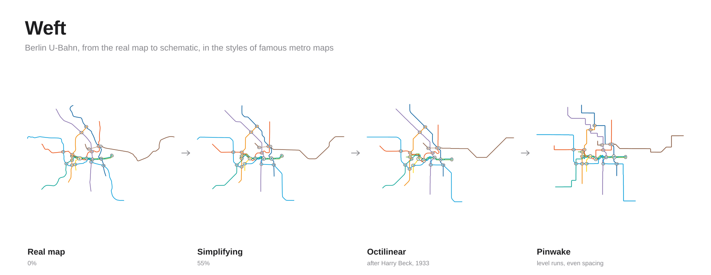
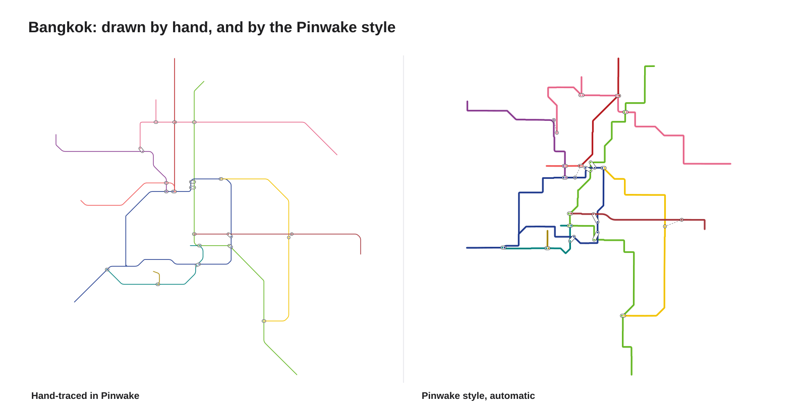
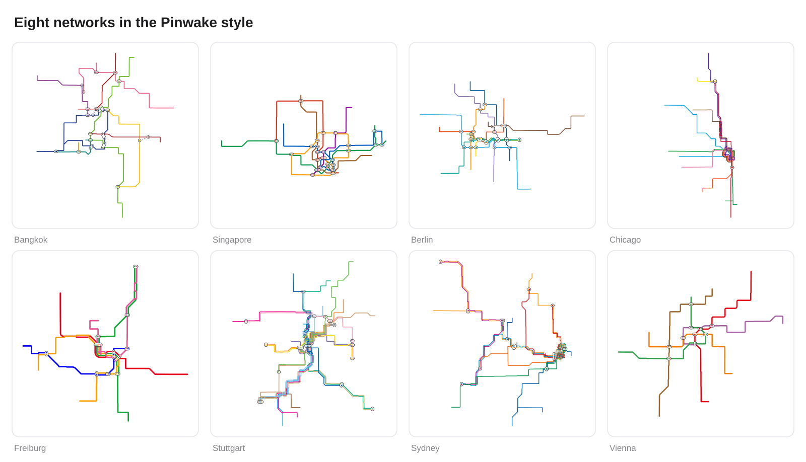

# Weft



The same rail network, drawn in the styles of famous metro maps, side by
side. A slider runs from the real map (0%) to fully schematic (100%), and
each style is scored so you can see *why* one reads better than another.

*Weft* is the thread woven across a loom: a nod to
[LOOM](https://github.com/ad-freiburg/loom), whose work this builds on.

It started as a tool for [Pinwake](#export-to-pinwake), an iPhone app that
wakes you before your stop, to lay out line diagrams for big networks
automatically instead of by hand.

## Run it

No build step, no dependencies:

```
python3 -m http.server 8765
open http://localhost:8765
```

Tests (Node 20+): `npm test`

### Apple Maps

The big view can sit on Apple Maps: at 0% the lines lie on the real
streets and move with the map; towards 100% the map fades out. This needs a
MapKit JS token:

1. In the Apple Developer site, create a **Maps ID**, then a **key** with
   MapKit JS enabled, and download its `.p8` file. Keep it private.
2. `node scripts/mapkit-token.mjs AuthKey_XXXX.p8 <KEY_ID> <TEAM_ID> http://localhost:8765`
3. Copy `js/config.example.js` to `js/config.js` (git-ignored) and paste the token.

Without a token the lab draws on a plain background.

## Deploy (Vercel)

The site is static. `api/mapkit-token.js` is the one serverless function: it
signs a 30-minute MapKit token on each visit, only for the site's own
address, so your private key never reaches the browser.

1. Push this repo to GitHub, then in Vercel choose **Add New → Project** and import it. No build settings are needed.
2. In **Settings → Environment Variables**, add:
   - `MAPKIT_TEAM_ID`: your Apple Developer team ID
   - `MAPKIT_KEY_ID`: the key's ID (the `XXXX` in `AuthKey_XXXX.p8`)
   - `MAPKIT_PRIVATE_KEY`: the whole `.p8` file, `BEGIN`/`END` lines included
   - `MAPKIT_ORIGINS` (optional): extra addresses such as a custom domain, comma-separated
3. Redeploy. The big view now sits on Apple Maps.

## Styles

| Style | After | Rules |
|---|---|---|
| Geographic | the real track | straightened as the slider moves |
| Octilinear | Harry Beck's London (1933), most official maps today | 0°/45°/90°, even spacing, straight runs |
| Pinwake | Pinwake's hand-traced Bangkok | octilinear, but mostly level and upright, few bends, stations evenly spaced between interchanges |
| Pinwake, by stretch | how that map was drawn | only interchanges move; each stretch between them is one straight run with at most one bend |
| Grid | Massimo Vignelli's New York (1972) | right angles only |
| Hexalinear | Max Roberts' 60° designs | 0°/60°/120° |
| Curvy | Max Roberts' curvilinear maps | smooth curves, even spacing |
| Circles | Max Roberts' concentric-circles maps | along and across circles around the centre |
| Hand-traced | Pinwake's own diagram | a reference, where a network has one |

### The Pinwake style



Learned from measuring Pinwake's hand-traced Bangkok:
- **Direction:** 77% of its track is level or upright, so diagonals cost extra.
- **Bends:** about 5 bends per line, so bends are weighted heavily.
- **Spacing:** interchanges and termini are pinned, and the stations between them slide along the drawn line until evenly spaced, which is exactly how the hand-traced map is built.

Every style is drawn in Pinwake's look:
- lanes for lines sharing track
- rounded bends
- one white pill per interchange, holding a dot per line
- ordinary stations shown only once there's room.

**Pinwake, by stretch** (`js/stretches.js`) copies how the hand-drawn map
was *made*, not just its look:
- **Stretches:** the network is cut into stretches between pins. Pins are
  interchanges, line ends, walkway stations, and the points where the real
  track turns sharply. That last test is Douglas–Peucker on the stations:
  a stretch whose stations stray far from its chord is split.
- **Pins only:** only pins move. Each stretch is one straight run at
  0°/45°/90°, or two runs joined by one bend, so it can't zigzag.
- **Even spacing:** stations are spaced evenly along each stretch.
- **Bend direction:** a stretch's bend flips the other way when that avoids
  crossing another line.

On Singapore this is the closest of all styles to the hand-drawn map
(1.24–1.29 station gaps off, against 1.68 for Octilinear). Bangkok's outer
lines still come out as long diagonals where the hand-drawn map runs them
level.

The next steps are planned:
- **Solve exactly:** choose each stretch's direction with a mixed-integer
  program, after Nöllenburg & Wolff, instead of local search.
- **Learn weights:** fit the weights to the hand-drawn Bangkok, then check
  them on Singapore.

### Known issues

- **Crossings:** "Pinwake, by stretch" still adds a crossing or two in
  Singapore, Berlin and Vienna, and Grid adds one in Bangkok. The tests pin
  these counts so they can't grow.
- **Crowded centres:** dense city centres stay crowded, because real maps
  also enlarge the middle.

## How it works

- **One optimiser for every style** (`js/layout.js`). It uses multi-criteria
  hill climbing on station positions, after Stott & Rodgers.
  - **The energy** weighs:
    - distance from the real position, with weight (1 − t)²
    - the style's allowed directions
    - even spacing
    - straight lines
    - clearance between stations and lines.
  - **Crossings:** moves that make lines cross where they don't in reality are refused.
  - **Order of work:** the angle rule fades in after the shape has smoothed, so neighbouring edges snap together into straight runs instead of zigzagging.
- **Drawing** (`js/paths.js`) bends the real track onto the moved stations
  and straightens it as t grows. Past halfway, each style takes over:
  - one allowed-angle bend per edge
  - Catmull–Rom curves
  - arcs around the centre.
- **Scores** (`js/metrics.js`):
  - angle error
  - turning per line
  - uneven spacing
  - new crossings
  - crowding
  - distance from the real map and from the hand-traced map.

  Distances are compared after aligning scale. "Best" is a weighted total,
  and you can change the weights on the page.

## Networks



Regenerate the images with `node scripts/render-readme.mjs`.

- **Bangkok, Singapore**: OpenStreetMap, via Pinwake's fetch scripts, with Pinwake's hand-traced layout as a reference.
- **Berlin, Chicago, Freiburg, Stuttgart, Sydney, Vienna**: LOOM's example graphs, converted by `scripts/import_loom.py`.

Licences and provenance are in [data/SOURCES.md](data/SOURCES.md). Any LOOM
line graph converts the same way, so a city LOOM can build from GTFS can be
added here.

## Export to Pinwake

"Export for Pinwake" downloads the selected layout:
- each station's `sx`/`sy`
- each line's `path`, bends included
- each stop's `offsets` along the path.

Everything is in a 0–1000 box. Pinwake's
`Design/RailData/apply_layout.py` merges it into a network file.

## Credits and prior art

This lab stands on other people's work:

- **[LOOM](https://github.com/ad-freiburg/loom)** by Patrick Brosi and the
  University of Freiburg's Chair of Algorithms and Data Structures. It's a
  complete open-source toolchain from GTFS to geographic and schematic
  transit maps. Its `octi` tool lays maps out on octilinear, ortholinear,
  hexalinear and orthoradial grid graphs, with optimal ILP and fast
  approximate solvers. If you need production-quality maps from GTFS, use
  LOOM. Six of the lab's networks are LOOM's example graphs. The lab's code
  is written from the papers, not from LOOM's (GPL-3.0) source.
  - H. Bast, P. Brosi, S. Storandt. *Metro Maps on Octilinear Grid Graphs*. EuroVis 2020.
  - H. Bast, P. Brosi, S. Storandt. *Metro Maps on Flexible Base Grids*. SSTD 2021.
  - P. Brosi, H. Bast. *Large-Scale Generation of Transit Maps from OpenStreetMap Data*. 2024.
- J. Stott, P. Rodgers, J. C. Martínez-Ovando, S. G. Walker. *Automatic
  Metro Map Layout Using Multicriteria Optimization*. IEEE TVCG, 2011.
- M. Nöllenburg, A. Wolff. *Drawing and Labeling High-Quality Metro Maps by
  Mixed-Integer Programming*. IEEE TVCG, 2011.
- M. Fink, H. Haverkort, M. Nöllenburg, M. Roberts, J. Schuhmann, A. Wolff.
  *Drawing Metro Maps Using Bézier Curves*. Graph Drawing 2012.
- M. J. Roberts et al. *Objective versus subjective measures of Paris Metro
  map usability* (2013), and the Berlin octilinear vs. concentric-circles
  study (2016). They're why the lab doesn't assume octilinear is best.

## Licence

Code: MIT ([LICENSE](LICENSE)). Data: see [data/SOURCES.md](data/SOURCES.md).
